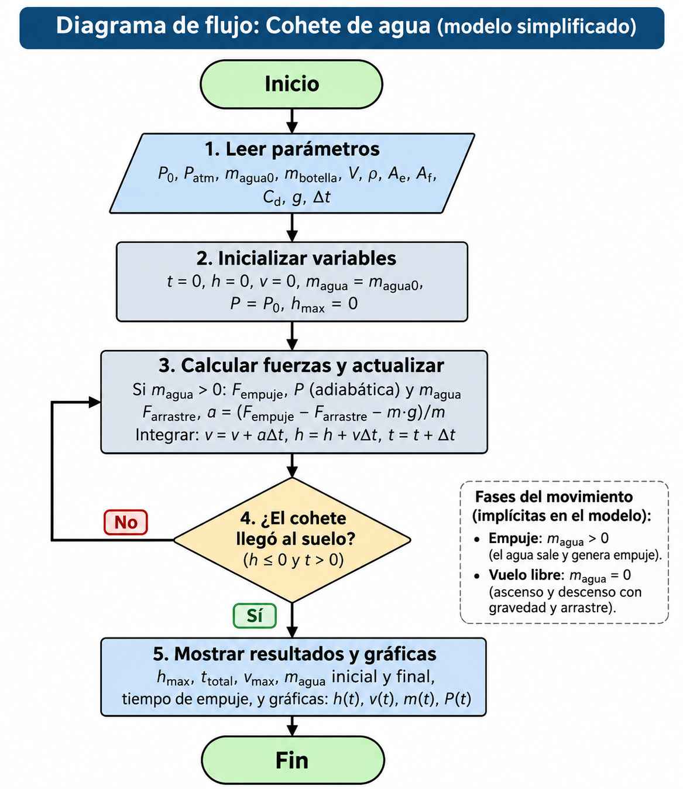
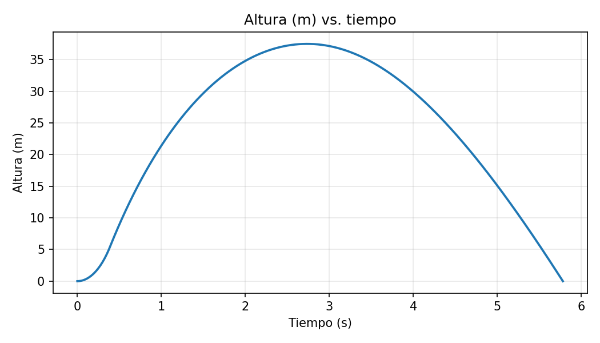
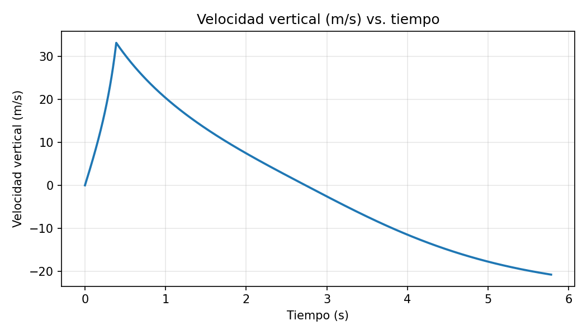
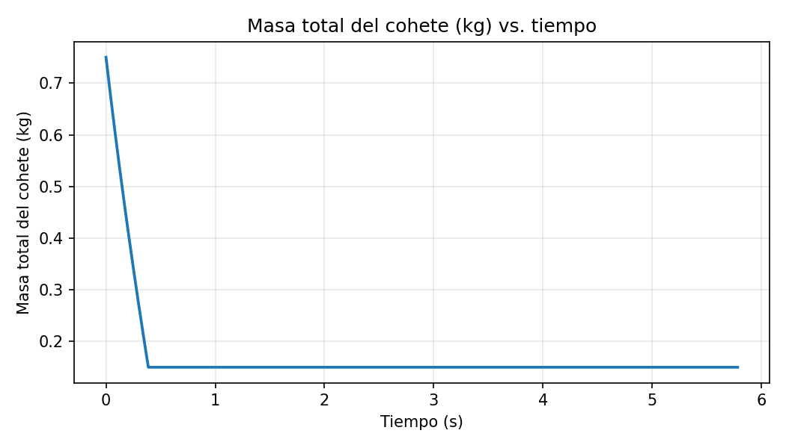
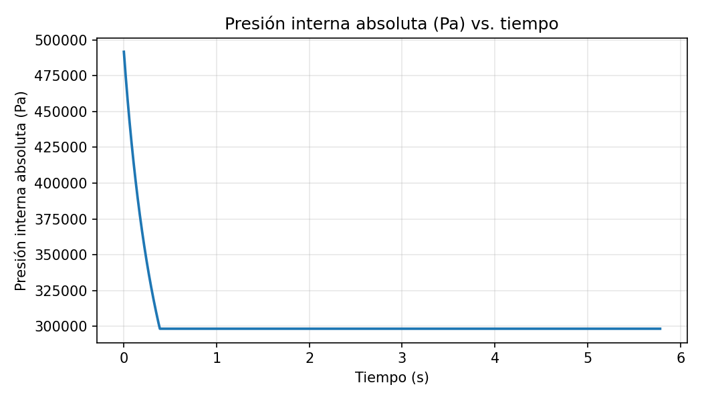

# TC1038 — Modelación vertical de un cohete de agua

**Actividad académica resuelta · Análisis EPS, diagrama de flujo, ecuaciones y código Python comentado**

> **Fuentes empleadas exclusivamente:** (1) *Modelado del movimiento de un cohete de agua: ecuaciones, simulación numérica y código Python*, M.C. Rafael Díaz Mondragón, 17 de noviembre de 2026, PDF adjunto (5 páginas); (2) *Modelado del movimiento de un cohete de agua*, presentación de clase adjunta, especialmente diapositivas 3, 4, 17–25 y 27. Las conversiones de unidades, la técnica de integración elegida y los valores no especificados se identifican como decisiones necesarias de implementación, **no como datos medidos**.

## 1. Objetivo de la actividad

En equipos, diseñar un algoritmo y programar en Python una simulación del movimiento vertical de un cohete de agua: despega impulsado por la expulsión del agua, asciende hasta alcanzar su altura máxima y desciende hasta el suelo. Usar el modelo de masa variable durante el empuje y considerar gravedad y resistencia aerodinámica durante todo el vuelo. Comparar los resultados con un video de lanzamiento y elaborar un reporte.

**Productos solicitados:** diagrama de flujo, programa comentado, cuatro gráficas (altura, velocidad, masa y presión vs. tiempo), y seis indicadores: altura máxima, tiempo total, velocidad máxima, masa inicial de agua, masa final de agua y duración del empuje.

## 2. Análisis EPS — Entrada, Proceso y Salida

| Elemento | Descripción |
|---|---|
| **Entrada** | Presión inicial manométrica en psi; presión atmosférica local en Pa; masas de agua y botella en kg; volumen total en m³; densidades del agua y aire en kg/m³; exponente adiabático γ; áreas de boquilla y frontal en m² (calculadas a partir de diámetros); coeficiente de arrastre; gravedad y paso de integración Δt. |
| **Proceso** | Convertir presión manométrica a absoluta, validar parámetros, inicializar estado `(t, h, v, m_agua)`, calcular presión adiabática, velocidad de expulsión, flujo de agua, empuje y arrastre; integrar ecuaciones diferenciales paso a paso; terminar cuando el cohete regrese al suelo. |
| **Salida** | Resultados numéricos, series de tiempo y gráficas de altura, velocidad, masa total y presión interna absoluta. |

## 3. Etapas físicas del vuelo

**Fase A. Empuje por agua.** El aire comprimido expulsa agua por la boquilla. El agua restante disminuye; también disminuye la masa total del cohete. El volumen de aire se expande, la presión decae y el empuje cambia con el tiempo. Se aplican Bernoulli, conservación de cantidad de movimiento y la segunda ley de Newton (PDF, pp. 2–4; presentación, diapositivas 3 y 12–24).

**Fase B. Ascenso sin empuje.** Después de agotarse el agua, se toma masa constante y empuje nulo. La gravedad y el arrastre frenan el ascenso hasta que `v = 0`, instante de altura máxima.

**Fase C. Descenso.** La velocidad se vuelve negativa; la gravedad acelera la caída y el arrastre se opone al movimiento hasta que `h ≤ 0` (aterrizaje).

**Simplificación adoptada:** la fase breve de empuje residual por aire, reconocida como opcional en ambas fuentes, **no se modela**. Tampoco se modelan inclinación, viento, estabilidad, rebotes ni movimientos horizontales. El informe se refiere a una trayectoria estrictamente vertical.

## 4. Diagrama de flujo simplificado



La figura conserva siete bloques: **Inicio → Leer parámetros → Inicializar variables → Calcular fuerzas y actualizar → ¿Llegó al suelo? → Mostrar resultados y gráficas → Fin**. Ante respuesta negativa en la decisión, se repite el cálculo. En la práctica, la condición de aterrizaje se comprueba después de avanzar el tiempo: `h <= 0` con `t > 0`.

### Interpretación del bloque de cálculo

1. Si queda agua y la presión interna supera la atmosférica, calcular velocidad de salida, gasto de agua, empuje y presión.
2. Calcular masa total, peso y arrastre (con signo opuesto a la velocidad).
3. Aplicar la segunda ley de Newton para obtener la aceleración vertical.
4. Actualizar velocidad, altura, masa de agua y tiempo mediante pasos pequeños de integración.
5. Registrar el estado y repetir mientras no se produzca el aterrizaje.

## 5. Ecuaciones del modelo físico

Tomamos **hacia arriba como positivo**. Estas ecuaciones sintetizan el PDF de referencia (pp. 2–4) y la presentación.

### 5.1 Masa total variable

\[
m(t) = m_{\mathrm{botella}} + m_{\mathrm{agua}}(t)
\]

Se desprecia la masa del aire, como establece el modelo de referencia.

### 5.2 Volumen de aire y presión adiabática

\[
V_a(t)=V_{\mathrm{total}}-\frac{m_{\mathrm{agua}}(t)}{\rho_{\mathrm{agua}}}
\]

\[
P_{\mathrm{abs}}(t)=P_{0,\mathrm{abs}}\left(\frac{V_a(0)}{V_a(t)}\right)^\gamma
\]

**Distinción esencial:** la presión inicial anunciada en el PDF es **manométrica** (60 psi), mientras que la ley adiabática debe calcularse con **presión absoluta**. Por tanto:

\[
P_{0,\mathrm{abs}}=P_{\mathrm{atm}}+P_{0,\mathrm{man}};\qquad
P_{0,\mathrm{man}}[\mathrm{Pa}]=60\times6894.757293168
\]

El factor psi→Pa es una conversión de unidades indispensable para ejecutar el modelo; no se trata de una medición atmosférica.

### 5.3 Velocidad de salida, gasto de agua y empuje

Cuando `m_agua > 0` y `P_abs > P_atm`:

\[
v_e=\sqrt{\frac{2(P_{\mathrm{abs}}-P_{\mathrm{atm}})}{\rho_{\mathrm{agua}}}},\quad
\dot m_{\mathrm{salida}}=\rho_{\mathrm{agua}}A_e v_e
\]

\[
F_{\mathrm{empuje}}=\dot m_{\mathrm{salida}}v_e=2A_e(P_{\mathrm{abs}}-P_{\mathrm{atm}})
\]

\[
\frac{dm_{\mathrm{agua}}}{dt}=-\dot m_{\mathrm{salida}}
\]

Aquí `A_e` es el área de la boquilla. Cuando se acaba el agua, el empuje del modelo simplificado pasa a cero.

### 5.4 Peso, arrastre y aceleración

\[
F_{\mathrm{arrastre,con\ signo}}=\frac12 C_d\rho_{\mathrm{aire}} A_f v|v|
\]

\[
a=\frac{F_{\mathrm{empuje}}-m(t)g-F_{\mathrm{arrastre,con\ signo}}}{m(t)}
\]

El producto `v |v|` hace que la fuerza de arrastre cambie correctamente de signo al pasar del ascenso al descenso. Sin empuje, la ecuación equivale a la fase de vuelo libre del PDF (p. 4).

### 5.5 Integración numérica

Las variables de estado son `h`, `v`, `m_agua`. El programa utiliza **Euler semiimplícito** (decisión de implementación para convertir las ecuaciones diferenciales de las fuentes a código):

\[
v_{n+1}=v_n+a_n\Delta t,\qquad
h_{n+1}=h_n+v_{n+1}\Delta t
\]

\[
m_{\mathrm{agua},n+1}=\max(0,m_{\mathrm{agua},n}-\dot m_{\mathrm{salida},n}\Delta t)
\]

El límite `max(0, …)` impide una masa de agua negativa por discretización. Se recomienda ensayar un `Δt` menor y comparar resultados para revisar la sensibilidad numérica.

## 6. Datos de entrada y procedencia

| Parámetro | Valor en ejemplo programado | Procedencia |
|---|---:|---|
| Presión manométrica inicial | 60 psi | PDF, pp. 1–2 |
| Masa de agua inicial | 0.60 kg | PDF, pp. 1–3 |
| Volumen total | 0.002 m³ (2 L) | Ejemplo ofrecido en el PDF, p. 3 |
| Densidad del agua | 1000 kg/m³ | PDF, p. 3 |
| γ | 1.4 | PDF, p. 3 |
| g | 9.81 m/s² | Instrucciones de la actividad |
| Presión atmosférica | 78000 Pa | **Supuesto ilustrativo**, no medición de Toluca |
| Densidad de aire | 1.10 kg/m³ | **Supuesto ilustrativo**, no medición de Toluca |
| Masa botella vacía | 0.15 kg | **Supuesto ilustrativo**; medir |
| Diámetro boquilla | 0.009 m | **Supuesto ilustrativo**; medir |
| Diámetro frontal | 0.105 m | **Supuesto ilustrativo**; medir |
| Coeficiente de arrastre | 0.50 | Ejemplo dentro del rango 0.3–0.8 indicado en PDF, p. 3 |
| Δt | 0.0005 s | Elección numérica para el ejemplo |

Las áreas se obtienen con `A = π(d/2)²`. Para realizar la comparación con el video es indispensable reemplazar todos los supuestos por medidas o estimaciones justificadas del prototipo real. La presión atmosférica y la densidad local no deben presentarse como medidas de Toluca mientras no se registren.

## 7. Código Python completo y comentado

**Requisitos:** Python 3 y la biblioteca `matplotlib`. El archivo `simulacion_cohete.py` incluido en el paquete contiene este mismo código. El programa genera los cuatro archivos PNG en la carpeta `recursos/`.

```python
"""TC1038: modelo didáctico vertical de cohete de agua.
Basado en los documentos proporcionados por el docente.
No incluye empuje residual del aire ni modela las aletas/estabilidad.
"""
from dataclasses import dataclass
from math import pi, sqrt
import matplotlib.pyplot as plt

PSI_A_PA = 6894.757293168

@dataclass
class Parametros:
    # Valores del PDF: presión manométrica 60 psi, agua inicial 0.60 kg,
    # botella de ejemplo 2 L, densidad del agua ~1000 kg/m³, gamma 1.4.
    presion_manometrica_psi: float = 60.0
    masa_agua_inicial: float = 0.60         # kg
    volumen_total: float = 0.002          # m³ = 2 L
    densidad_agua: float = 1000.0          # kg/m³
    gamma: float = 1.4
    gravedad: float = 9.81                 # m/s²

    # VALORES ILUSTRATIVOS: sustituir por mediciones del equipo.
    presion_atmosferica: float = 78000.0   # Pa, NO medición verificada de Toluca
    masa_botella_vacia: float = 0.15       # kg
    densidad_aire: float = 1.10           # kg/m³, NO medición verificada de Toluca
    diametro_boquilla: float = 0.009      # m
    diametro_frontal: float = 0.105       # m
    coeficiente_arrastre: float = 0.50    # adimensional
    dt: float = 0.0005                    # s
    tiempo_maximo: float = 120.0          # s (límite de seguridad numérica)


def validar(p):
    """Evita parámetros incompatibles con el modelo físico."""
    if p.presion_manometrica_psi <= 0 or p.presion_atmosferica <= 0:
        raise ValueError("Las presiones deben ser positivas.")
    if p.masa_agua_inicial <= 0 or p.masa_botella_vacia <= 0:
        raise ValueError("Las masas deben ser positivas.")
    if p.densidad_agua <= 0 or p.densidad_aire <= 0:
        raise ValueError("Las densidades deben ser positivas.")
    if not (0 < p.masa_agua_inicial / p.densidad_agua < p.volumen_total):
        raise ValueError("El agua debe ocupar menos volumen que la botella.")
    if p.gamma <= 1 or p.gravedad <= 0 or p.dt <= 0 or p.tiempo_maximo <= 0:
        raise ValueError("Gamma, gravedad y tiempos no son válidos.")
    if p.diametro_boquilla <= 0 or p.diametro_frontal <= 0 or p.coeficiente_arrastre < 0:
        raise ValueError("Revise diámetros y coeficiente de arrastre.")


def simular(p):
    """Integra altura, velocidad y masa mediante Euler semiimplícito."""
    validar(p)
    area_boquilla = pi * (p.diametro_boquilla / 2) ** 2
    area_frontal = pi * (p.diametro_frontal / 2) ** 2
    presion_inicial_abs = p.presion_atmosferica + p.presion_manometrica_psi * PSI_A_PA
    volumen_aire_inicial = p.volumen_total - p.masa_agua_inicial / p.densidad_agua

    t, h, v, m_agua = 0.0, 0.0, 0.0, p.masa_agua_inicial
    t_hist, h_hist, v_hist = [t], [h], [v]
    ma_hist, masa_total_hist, p_hist = [m_agua], [p.masa_botella_vacia + m_agua], [presion_inicial_abs]
    t_fin_empuje = 0.0
    empuje_terminado = False
    altura_maxima = 0.0
    velocidad_maxima = 0.0

    while t < p.tiempo_maximo:
        masa_total = p.masa_botella_vacia + m_agua
        # Ecuación adiabática: usar presiones ABSOLUTAS.
        vol_aire = p.volumen_total - m_agua / p.densidad_agua
        presion_abs = presion_inicial_abs * (volumen_aire_inicial / vol_aire) ** p.gamma
        delta_p = max(0.0, presion_abs - p.presion_atmosferica)

        # Expulsión de agua: Bernoulli + cantidad de movimiento.
        empuje = 0.0
        flujo_masico = 0.0
        if m_agua > 0 and delta_p > 0:
            velocidad_salida = sqrt(2 * delta_p / p.densidad_agua)
            flujo_masico = p.densidad_agua * area_boquilla * velocidad_salida
            empuje = flujo_masico * velocidad_salida
        elif not empuje_terminado:
            t_fin_empuje = t
            empuje_terminado = True

        # El arrastre se opone tanto al ascenso como al descenso.
        arrastre_con_signo = 0.5 * p.coeficiente_arrastre * p.densidad_aire * area_frontal * v * abs(v)
        aceleracion = (empuje - masa_total * p.gravedad - arrastre_con_signo) / masa_total

        # Integración numérica: primero velocidad, luego altura.
        v = v + aceleracion * p.dt
        h = h + v * p.dt
        t = t + p.dt
        m_agua = max(0.0, m_agua - flujo_masico * p.dt)

        # Detectar momento de agotamiento del agua.
        if not empuje_terminado and m_agua == 0:
            t_fin_empuje = t
            empuje_terminado = True

        # Después del agua no se modela la expulsión residual de aire.
        # La presión interna termodinámica residual se mantiene como valor
        # calculado; NO se supone que haya caído instantáneamente a Patm.
        vol_aire_nuevo = p.volumen_total - m_agua / p.densidad_agua
        presion_registro = presion_inicial_abs * (volumen_aire_inicial / vol_aire_nuevo) ** p.gamma
        t_hist.append(t)
        h_hist.append(max(h, 0.0))
        v_hist.append(v)
        ma_hist.append(m_agua)
        masa_total_hist.append(p.masa_botella_vacia + m_agua)
        p_hist.append(presion_registro)
        altura_maxima = max(altura_maxima, h)
        velocidad_maxima = max(velocidad_maxima, v)

        # h<=0 al regresar al suelo; t>0 evita finalizar en el lanzamiento.
        if h <= 0 and t > p.dt:
            break
    else:
        raise RuntimeError("No se detectó aterrizaje; revise parámetros o tiempo máximo.")

    return {
        "tiempo": t_hist, "altura": h_hist, "velocidad": v_hist,
        "masa_agua": ma_hist, "masa_total": masa_total_hist, "presion_abs": p_hist,
        "altura_maxima": altura_maxima, "velocidad_maxima": velocidad_maxima,
        "tiempo_vuelo": t, "tiempo_empuje": t_fin_empuje,
        "masa_agua_inicial": p.masa_agua_inicial, "masa_agua_final": m_agua,
        "presion_atmosferica": p.presion_atmosferica,
    }


def graficar(r, carpeta="recursos"):
    """Guarda las cuatro gráficas solicitadas en archivos PNG."""
    from pathlib import Path
    Path(carpeta).mkdir(parents=True, exist_ok=True)
    series = [
        ("altura", "Altura (m)", "01_altura.png"),
        ("velocidad", "Velocidad vertical (m/s)", "02_velocidad.png"),
        ("masa_total", "Masa total del cohete (kg)", "03_masa.png"),
        ("presion_abs", "Presión interna absoluta (Pa)", "04_presion.png"),
    ]
    for clave, ylabel, filename in series:
        fig, ax = plt.subplots(figsize=(7, 4))
        ax.plot(r["tiempo"], r[clave], linewidth=1.8)
        ax.set_xlabel("Tiempo (s)")
        ax.set_ylabel(ylabel)
        ax.set_title(f"{ylabel} vs. tiempo")
        ax.grid(True, alpha=0.3)
        fig.tight_layout()
        fig.savefig(Path(carpeta) / filename, dpi=150)
        plt.close(fig)


def main():
    parametros = Parametros()
    resultados = simular(parametros)
    print("RESULTADOS DE LA SIMULACIÓN (parámetros ilustrativos)")
    print(f"Altura máxima: {resultados['altura_maxima']:.2f} m")
    print(f"Tiempo total de vuelo: {resultados['tiempo_vuelo']:.3f} s")
    print(f"Velocidad máxima de ascenso: {resultados['velocidad_maxima']:.2f} m/s")
    print(f"Masa inicial de agua: {resultados['masa_agua_inicial']:.3f} kg")
    print(f"Masa final de agua: {resultados['masa_agua_final']:.6f} kg")
    print(f"Duración del empuje: {resultados['tiempo_empuje']:.3f} s")
    graficar(resultados)


if __name__ == "__main__":
    main()
```

## 8. Prueba de ejecución con parámetros ilustrativos

La siguiente salida se obtuvo ejecutando el programa con los valores de la tabla precedente (incluidos los supuestos):

```text
RESULTADOS DE LA SIMULACIÓN (parámetros ilustrativos)
Altura máxima: 37.50 m
Tiempo total de vuelo: 5.781 s
Velocidad máxima de ascenso: 33.09 m/s
Masa inicial de agua: 0.600 kg
Masa final de agua: 0.000000 kg
Duración del empuje: 0.388 s
```

**Importante:** los indicadores **no son predicciones validadas del lanzamiento**. Por ejemplo, la diapositiva 27 de la presentación proporciona para *su* simulación: altura máxima **44.67 m**, tiempo de vuelo **7.14 s**, velocidad máxima **42.14 m/s**, masa inicial de agua **0.60 kg**, masa final **0 kg** y duración del empuje **1.254 s**. No debe suponerse igualdad porque no se han documentado en este archivo todas las dimensiones y condiciones numéricas empleadas en aquella corrida. El conjunto de parámetros usado aquí es distinto y está identificado.

### Gráficas generadas

**Altura contra tiempo**



**Velocidad vertical contra tiempo**



**Masa total del cohete contra tiempo**



**Presión interna absoluta contra tiempo**



**Lectura física de las gráficas:** la altura aumenta y luego retorna a cero; la velocidad es positiva en el ascenso, pasa por cero en el máximo y se vuelve negativa en el descenso; la masa total desciende durante la expulsión de agua y queda constante; la presión adiabática disminuye mientras el aire se expande.

**Precisión respecto a la presión:** en esta versión se grafica la **presión interna absoluta calculada**. Una vez agotada el agua, el código conserva el valor residual de la presión de acuerdo con la relación adiabática, pero **no simula** el vaciado posterior del aire; por ello, la curva es horizontal en vuelo libre. No debe interpretarse como una medición real de presión durante todo el vuelo. El PDF presenta la evolución del empuje y presión y también deja explícita la omisión del empuje residual por aire (pp. 2 y 5).

## 9. Pruebas de escritorio y comprobaciones

| Prueba | Resultado esperado |
|---|---|
| Inicio | `t = 0`, `h = 0`, `v = 0`, `m_agua = 0.60 kg`. |
| Durante el empuje | `m_agua` disminuye, `h` y `v` aumentan inicialmente; existe empuje. |
| Al agotarse el agua | `m_agua = 0`, `F_empuje = 0`, masa total constante. |
| En la altura máxima | Velocidad cercana a 0 y cambio de signo de positiva a negativa. |
| Durante la caída | `v < 0`; el arrastre actúa hacia arriba. |
| En el suelo | `h ≤ 0` detiene el bucle; la altura registrada final se limita a cero. |
| Volumen de agua ≥ volumen botella | Se produce un error de validación antes de iniciar. |

### Límites y mejoras para investigación posterior

- **Modelo físico:** 1D, sin viento y sin empuje residual por aire; se desprecia la masa de aire. Son simplificaciones adoptadas a partir de las fuentes.
- **Discretización:** usar menor `Δt` y comparar métricas; el tiempo y la altura exactos de aterrizaje tienen error del tamaño del paso (no se interpola el cruce por el suelo).
- **Presión absoluta y manométrica:** no intercambiar sus valores en las ecuaciones.
- **Seguridad experimental:** el PDF advierte que 60 psi puede ser alto para una botella PET típica y que debe comprobarse la resistencia del recipiente (p. 5). La simulación no acredita la seguridad de un lanzamiento.

## 10. Actividad para equipos: trabajo y entrega

1. **Identificar** qué parámetros conocen del video y del prototipo, y cuáles deben medir.
2. **Explicar** las tres etapas: empuje, ascenso libre y caída.
3. **Interpretar** el diagrama de siete bloques usando el análisis EPS.
4. **Ejecutar** el programa y sustituir los supuestos por datos justificados del lanzamiento.
5. **Comparar** altura máxima y tiempo total con lo observado en la grabación; documentar discrepancias.
6. **Entregar** código comentado, tablas de parámetros, cuatro gráficas y reporte técnico con los seis indicadores.

**Preguntas de análisis:** ¿Por qué disminuye la masa durante el empuje? ¿Qué variable cambia el signo del arrastre? ¿Qué implica usar presión manométrica en lugar de absoluta en la expansión adiabática? ¿Por qué la altura máxima no coincide con la desaparición del empuje? ¿Qué ocurre al elegir un paso `Δt` demasiado grande?

## 11. Referencias utilizadas

1. Díaz Mondragón, Rafael. *Modelado del movimiento de un cohete de agua: ecuaciones, simulación numérica y código Python*. Documento PDF adjunto, 17 de noviembre de 2026, pp. 1–5.
2. Díaz Mondragón, Rafael. *Modelado del movimiento de un cohete de agua*. Presentación de clase adjunta, 27 diapositivas (incluye resultados en diapositiva 27).

*No se consultaron fuentes externas. Las decisiones y parámetros necesarios para implementar una simulación reproducible se explican explícitamente en el documento.*
