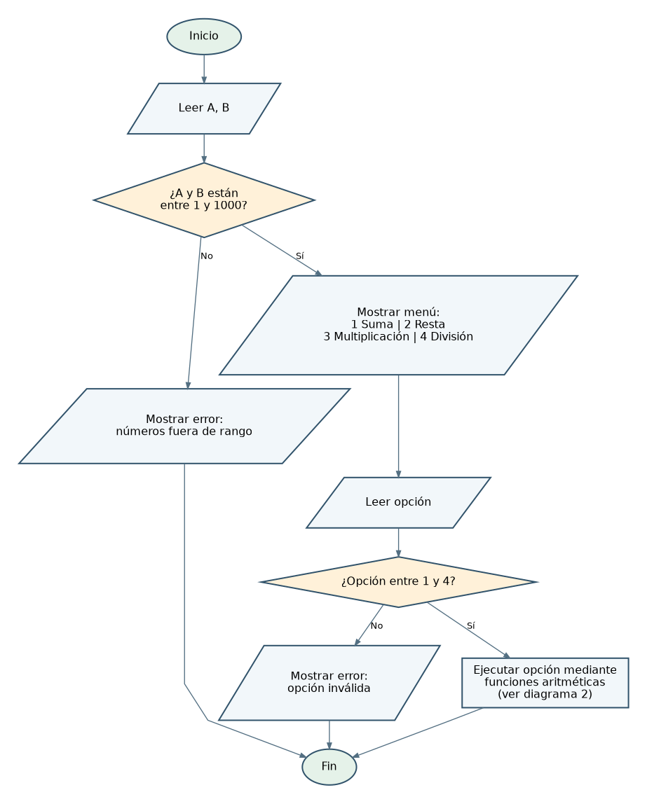
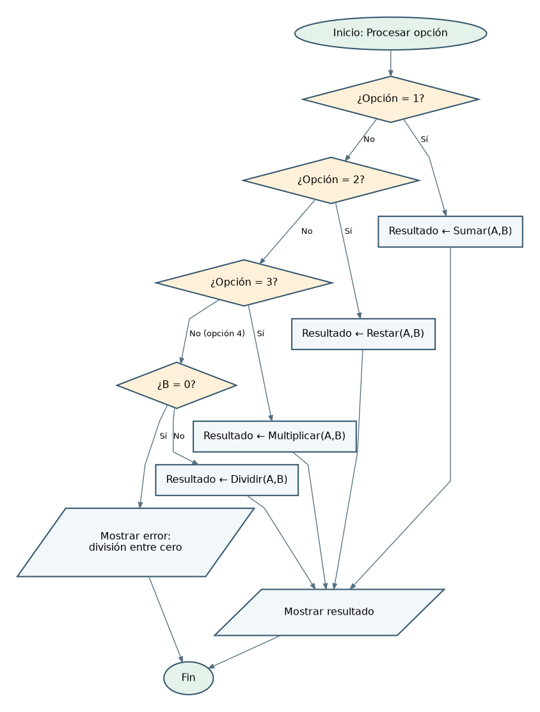
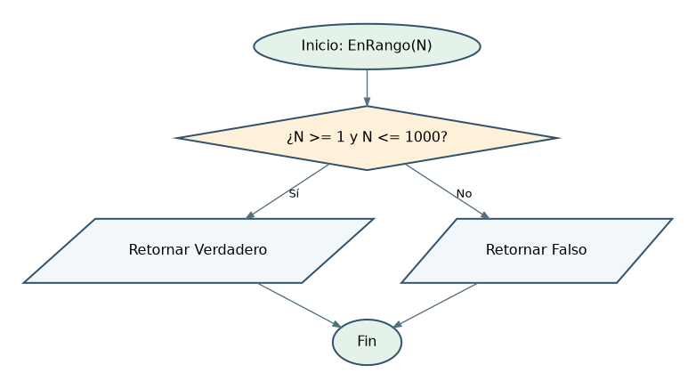

# TC1038 — Pensamiento Computacional

## Actividad: Calculadora con funciones, validaciones y diagramas de flujo

**Objetivo.** Solicitar dos números, comprobar que ambos pertenezcan al intervalo cerrado **[1, 1000]**, presentar cuatro operaciones y ejecutar una opción válida utilizando funciones. La solución utiliza **pseudocódigo PSeInt**, no Python.

## 1. Análisis EPS (Entrada – Proceso – Salida)

| Elemento | Descripción |
|---|---|
| **Entrada** | Dos valores numéricos reales `A` y `B`, y una opción entera `opcion`. |
| **Proceso** | (1) Leer `A` y `B`. (2) Validar `1 <= A <= 1000` y `1 <= B <= 1000`. (3) Si son válidos, mostrar menú. (4) Leer y validar opción de 1 a 4. (5) Ejecutar la función solicitada. (6) Antes de dividir, comprobar `B <> 0`. |
| **Salida** | Resultado de suma, resta, multiplicación o división; alternativamente, mensaje de error por valores fuera de rango, opción inválida o división entre cero. |

**Decisión de diseño:** ante una entrada incorrecta, el programa **muestra el error y termina**. No repite la lectura porque las instrucciones no exigen reintentos. Se admiten decimales y números enteros dentro del intervalo.

## 2. Diagramas de flujo

### Diagrama 1. Programa principal



### Diagrama 2. Selección de operación y llamadas a funciones



### Diagrama 3. Función de validación del intervalo



**Nota:** en el diagrama 2, la opción ya fue validada por el programa principal. Por tanto, si no es 1, 2 ni 3, necesariamente es 4.

## 3. Pseudocódigo compatible con PSeInt

```pseint
Funcion valido <- EnRango(numero)
    Definir valido Como Logico
    valido <- numero >= 1 Y numero <= 1000
FinFuncion

Funcion resultado <- Sumar(a, b)
    Definir resultado Como Real
    resultado <- a + b
FinFuncion

Funcion resultado <- Restar(a, b)
    Definir resultado Como Real
    resultado <- a - b
FinFuncion

Funcion resultado <- Multiplicar(a, b)
    Definir resultado Como Real
    resultado <- a * b
FinFuncion

Funcion resultado <- Dividir(a, b)
    Definir resultado Como Real
    resultado <- a / b
FinFuncion

Algoritmo CalculadoraConFunciones
    Definir a, b, resultado Como Real
    Definir opcion Como Entero

    Escribir "Ingrese el primer numero (entre 1 y 1000):"
    Leer a
    Escribir "Ingrese el segundo numero (entre 1 y 1000):"
    Leer b

    Si EnRango(a) Y EnRango(b) Entonces
        Escribir "----- MENU DE OPERACIONES -----"
        Escribir "1. Suma"
        Escribir "2. Resta"
        Escribir "3. Multiplicacion"
        Escribir "4. Division"
        Escribir "Seleccione una opcion (1 a 4):"
        Leer opcion

        Si opcion >= 1 Y opcion <= 4 Entonces
            Segun opcion Hacer
                1:
                    resultado <- Sumar(a, b)
                    Escribir "Resultado de la suma: ", resultado
                2:
                    resultado <- Restar(a, b)
                    Escribir "Resultado de la resta: ", resultado
                3:
                    resultado <- Multiplicar(a, b)
                    Escribir "Resultado de la multiplicacion: ", resultado
                4:
                    Si b = 0 Entonces
                        Escribir "Error: no se puede dividir entre cero."
                    SiNo
                        resultado <- Dividir(a, b)
                        Escribir "Resultado de la division: ", resultado
                    FinSi
            FinSegun
        SiNo
            Escribir "Error: la opcion debe estar entre 1 y 4."
        FinSi
    SiNo
        Escribir "Error: ambos numeros deben estar entre 1 y 1000."
    FinSi
FinAlgoritmo
```

### Funciones utilizadas

| Función | Parámetros | Valor devuelto |
|---|---|---|
| `EnRango(numero)` | Un número | `Verdadero` si está entre 1 y 1000; de lo contrario, `Falso`. |
| `Sumar(a,b)` | Dos números | `a + b` |
| `Restar(a,b)` | Dos números | `a - b` |
| `Multiplicar(a,b)` | Dos números | `a * b` |
| `Dividir(a,b)` | Dos números | `a / b`; **solo debe invocarse después de comprobar que `b` no sea cero**. |

## 4. Pruebas de escritorio

| Caso | A | B | Opción | Salida esperada |
|---|---:|---:|---:|---|
| Suma | 200 | 30 | 1 | `230` |
| Resta | 20 | 45 | 2 | `-25` |
| Multiplicación | 12 | 8 | 3 | `96` |
| División | 125 | 5 | 4 | `25` |
| Valor mínimo permitido | 1 | 1 | 1 | `2` |
| Valor máximo permitido | 1000 | 1000 | 3 | `1000000` |
| Primer valor fuera del intervalo | 0 | 20 | — | Error de rango; no aparece el menú |
| Segundo valor fuera del intervalo | 40 | 1001 | — | Error de rango; no aparece el menú |
| Opción inválida | 10 | 5 | 5 | Error: opción entre 1 y 4 |
| Entrada decimal válida | 3.5 | 2 | 1 | `5.5` |

**Importante sobre la división entre cero:** con la condición obligatoria `1 <= B <= 1000`, `B = 0` es **imposible después de pasar la validación inicial**. Por ello, una prueba con `A=10`, `B=0`, `opcion=4` produciría primero el **error de rango**, sin mostrar el menú. La comprobación `Si b = 0` se conserva como **programación defensiva**, por si el intervalo permitido cambia en el futuro. No debe afirmarse que la rama de división entre cero es alcanzable con las reglas actuales.

## 5. Explicación del algoritmo

1. **Entrada:** el usuario ingresa `a` y `b`.
2. **Validación:** `EnRango` comprueba los extremos inclusivos, 1 y 1000. Si alguno falla, se informa y termina.
3. **Menú:** solo se despliega si los dos valores son válidos.
4. **Selección:** se lee `opcion`; si no está entre 1 y 4, se muestra el error y termina.
5. **Proceso aritmético:** `Segun` llama a una de las cuatro funciones. En la opción 4 se evalúa primero `b = 0`.
6. **Salida:** se imprime el resultado obtenido o el mensaje de error correspondiente.

## 6. Observaciones para estudiantes

- En PSeInt, `Y` es el operador lógico de conjunción, `<-` asigna un valor, `<>` representa distinto de y `Segun ... Hacer` selecciona una alternativa.
- **Validar el dato de entrada** es diferente de **validar la operación**; ambas medidas son importantes.
- La resta puede dar un valor negativo aunque ambos operandos estén entre 1 y 1000.
- El resultado de la multiplicación puede exceder 1000; **el rango aplica a los datos de entrada**, no al resultado.
- El pseudocódigo supone que el usuario introduce valores numéricos donde se solicitan números; el manejo de texto no numérico no forma parte del alcance del problema.
- Separar operaciones en funciones facilita reutilización, pruebas y mantenimiento.

## 7. Resumen

Se desarrolló un algoritmo modular en **PSeInt**, con una función de validación y cuatro funciones aritméticas. Se incorporaron las validaciones de entrada, selección de opción y división entre cero. Los tres diagramas ilustran el programa principal, la lógica de operaciones y la función de rango.
