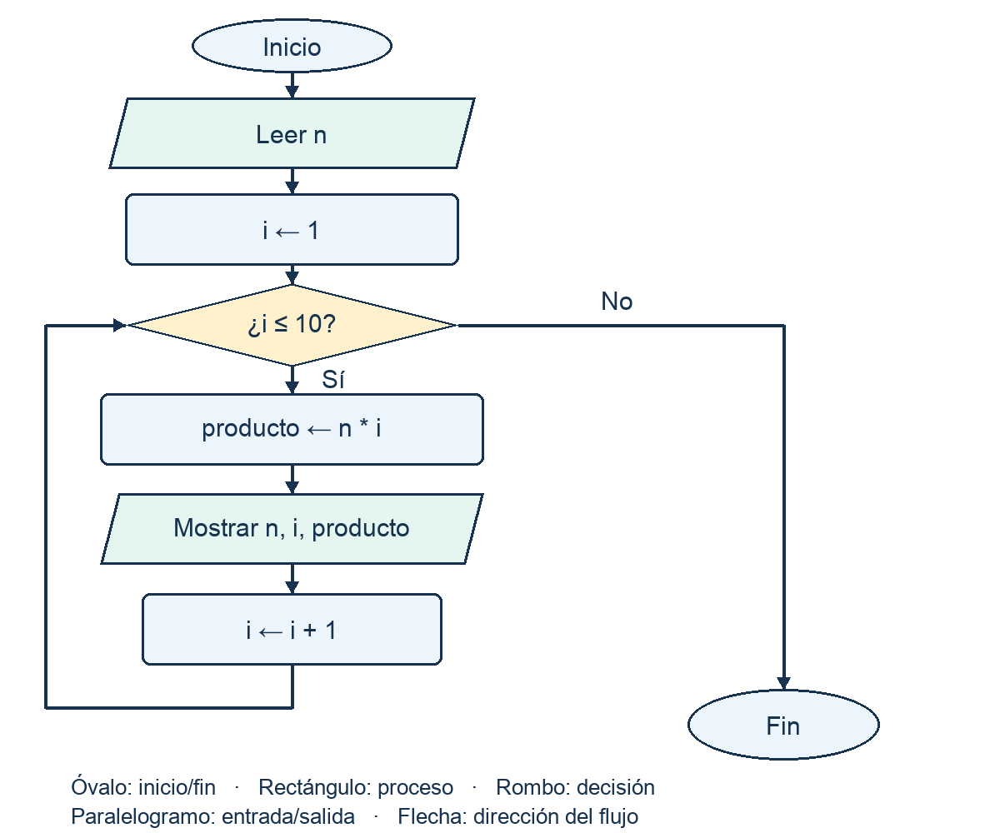
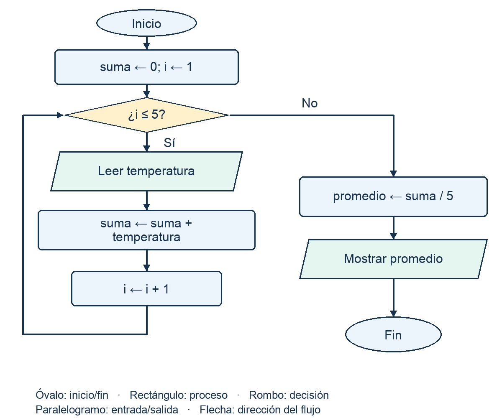

# W7 · Estructura de control For

## Repetir instrucciones con un contador

**TC1037B · Estudiantes de ingeniería**

Análisis EPS → diagrama de flujo → PSeInt → Python

---

# ¿Para qué sirve un ciclo For?

Un ciclo repite un bloque de instrucciones para cada valor de una secuencia.

- Úsalo para una cantidad conocida de repeticiones o un recorrido definido.
- Evita copiar la misma instrucción muchas veces.
- En ingeniería: procesar mediciones, generar tablas o recorrer muestras.

**Objetivo:** identificar inicio, límite, paso y cuerpo; después traducir un algoritmo a código.

En Python, `for` recorre cualquier iterable; aquí usaremos secuencias de enteros con `range`.

---

# Análisis EPS: antes de programar

| Elemento | Pregunta | Ejemplo: cinco mediciones |
|---|---|---|
| Entrada | ¿Qué datos necesito? | Cinco temperaturas en °C |
| Proceso | ¿Qué hago con ellos? | Sumar y dividir entre cinco |
| Salida | ¿Qué resultado entrego? | Temperatura promedio en °C |

Un **contador** registra el avance del ciclo: `i`.

Un **acumulador** conserva resultados parciales: `suma`.

---

# Anatomía del ciclo en PSeInt

```text
Para i <- 1 Hasta 5 Con Paso 1 Hacer
    Escribir i;
FinPara
```

1. Inicializar `i` en 1.
2. Verificar el límite; con paso positivo, continuar mientras `i <= 5`.
3. Ejecutar el cuerpo y aumentar `i` en 1.
4. Volver a verificar el límite.

Se muestran **1, 2, 3, 4, 5**. El incremento lo realiza `Para`.

---

# Traducción a Python y límites

```python
for i in range(1, 6):
    print(i)
```

| Propiedad | PSeInt | Python |
|---|---|---|
| Inicio | `1` | `1` |
| Límite | `Hasta 5` inclusivo | `6` exclusivo |
| Paso | `Con Paso 1` | `1` si se omite |
| Cuerpo | Hasta `FinPara` | Bloque con sangría |

Para recorrer de 1 a `n`, inclusive: `range(1, n + 1)`.

---

# Notas sobre range

`range(inicio, fin, paso)` genera una secuencia de enteros.

| Expresión | Valores recorridos |
|---|---|
| `range(5)` | 0, 1, 2, 3, 4 |
| `range(2, 9, 2)` | 2, 4, 6, 8 |
| `range(5, 0, -1)` | 5, 4, 3, 2, 1 |
| `range(5, 1)` | Ninguno: paso positivo |

El paso no puede ser cero. Los argumentos deben ser enteros.
Para descender en PSeInt, escribe explícitamente `Con Paso -1`.

---

# Ejemplo 1 · Tabla de multiplicar

**Problema:** leer un entero y mostrar sus productos del 1 al 10.

| EPS | Descripción |
|---|---|
| Entrada | Un entero `n`, positivo, negativo o cero |
| Proceso | Para cada `i` de 1 a 10, calcular `n * i` |
| Salida | Diez renglones: `n x i = producto` |

**Supuesto de entrada:** se proporciona un entero válido.

El límite es fijo: el ciclo ejecuta su cuerpo **10 veces**.

---

# Ejemplo 1 · Diagrama de flujo



<!-- La inicialización, condición e incremento representan internamente el Para. -->

---

# Ejemplo 1 · Pseudocódigo PSeInt

```text
Proceso TablaMultiplicar
    Definir n, i, producto Como Entero;
    Escribir "Ingrese un entero:";
    Leer n;
    Para i <- 1 Hasta 10 Con Paso 1 Hacer
        producto <- n * i;
        Escribir n, " x ", i, " = ", producto;
    FinPara
FinProceso
```

El contador `i` cambia automáticamente al finalizar cada repetición.

---

# Ejemplo 1 · Código Python

```python
n = int(input("Ingrese un entero: "))
for i in range(1, 11):
    producto = n * i
    print(n, "x", i, "=", producto)
```

- `int` convierte el texto capturado a entero.
- `11` queda fuera del recorrido: el último multiplicador es `10`.
- Los dos puntos y la sangría de cuatro espacios delimitan el cuerpo.

Con `n = 7`: primer renglón `7 x 1 = 7`; último `7 x 10 = 70`.

---

# Ejemplo 1 · Comprobación manual

| Entrada | Primer producto | Último producto | Renglones |
|---|---:|---:|---:|
| 7 | 7 | 70 | 10 |
| 0 | 0 | 0 | 10 |
| -3 | -3 | -30 | 10 |

Para `n = 7`, los primeros estados son:

`i = 1 → producto = 7` · `i = 2 → producto = 14`.

Al terminar la vuelta con `i = 10`, no se ejecuta otra vuelta.

---

# Ejemplo 2 · Promedio de temperaturas

**Problema:** calcular el promedio de cinco lecturas de un sensor.

| EPS | Descripción |
|---|---|
| Entrada | Cinco temperaturas reales en °C |
| Proceso | Inicializar suma en 0, acumular y dividir entre 5 |
| Salida | Promedio de las cinco temperaturas en °C |

**Supuestos:** entradas numéricas finitas, todas en °C.
En Python, usa punto decimal, por ejemplo `22.5`.

Las temperaturas negativas son válidas. Se capturan cinco datos.

---

# Ejemplo 2 · Diagrama de flujo



<!-- La lectura se repite; la división se realiza después del ciclo. -->

---

# Ejemplo 2 · Pseudocódigo PSeInt

```text
Proceso PromedioTemperaturas
    Definir i Como Entero;
    Definir temperatura, suma, promedio Como Real;
    suma <- 0;
    Para i <- 1 Hasta 5 Con Paso 1 Hacer
        Escribir "Temperatura ", i, " en C:";
        Leer temperatura;
        suma <- suma + temperatura;
    FinPara
    promedio <- suma / 5;
    Escribir "Promedio en C: ", promedio;
FinProceso
```

---

# Ejemplo 2 · Código Python

```python
suma = 0.0
for i in range(1, 6):
    temperatura = float(input(f"Temperatura {i} en C: "))
    suma = suma + temperatura
promedio = suma / 5
print("Promedio en C:", promedio)
```

`float` admite valores con decimales.

Inicializa `suma` **antes** del ciclo. Calcula el promedio **después**.
El divisor es 5 porque siempre se capturan cinco lecturas.

---

# Ejemplo 2 · Prueba de escritorio

| Vuelta `i` | Temperatura (°C) | Suma acumulada (°C) |
|---|---:|---:|
| 1 | 20 | 20 |
| 2 | 22 | 42 |
| 3 | 21 | 63 |
| 4 | 23 | 86 |
| 5 | 24 | 110 |

**Salida:** `Promedio en C: 22.0` porque `110 / 5 = 22`.

---

# Errores frecuentes y cómo evitarlos

- `range(1, 10)` hace 9 vueltas: para incluir 10, usa `range(1, 11)`.
- Reiniciar `suma` dentro del ciclo elimina lo acumulado.
- Una sangría incorrecta cambia qué instrucciones se repiten.
- No incrementes manualmente el contador en estos ciclos.
- Para entradas no numéricas, estas versiones necesitan validación adicional.

**Actividad:** adapta el promedio a `n` lecturas. Exige un entero `n > 0`, usa `range(1, n + 1)` y divide entre `n`.

---

# Verificación y alcance

- Python: compilación y ejecución de ambos bloques con casos normales, cero, negativos y decimales según el tipo de entrada.
- Tabla: se comprueban los diez renglones de cada ejecución.
- Promedio: se comprueban cinco lecturas y el resultado numérico.
- PSeInt: revisión de declaraciones, asignaciones, delimitadores y sintaxis contra su documentación oficial; no ejecución en el intérprete.
- Diagramas: corresponden a la inicialización, decisión, cuerpo, incremento y salida de cada algoritmo.

Los ejemplos suponen entradas válidas; no incluyen manejo de errores de conversión.

---

# Fuentes y uso del material

- [PSeInt: sintaxis oficial del pseudocódigo](https://pseint.sourceforge.net/pseudocodigo.php).
- [Python: ciclos for y función range](https://docs.python.org/3/tutorial/controlflow.html).

Descomprime el ZIP completo y conserva el Markdown junto a la carpeta `imagenes`. Abre el archivo con un visor compatible con **Marp**.

Las imágenes PNG son locales: no requieren Mermaid ni conexión a Internet. Al exportar con Marp CLI, habilita recursos locales con `--allow-local-files`.

El Markdown usa front matter Marp, formato 16:9 y separadores `---`.
