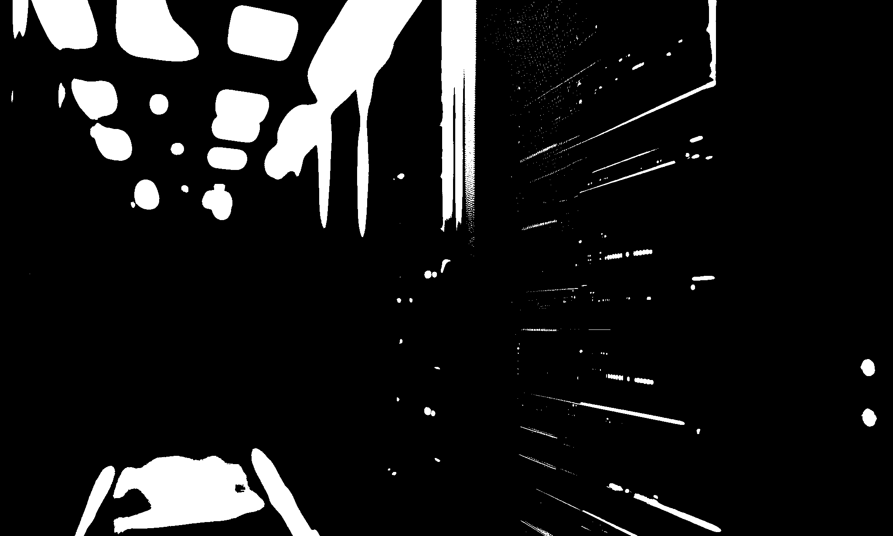
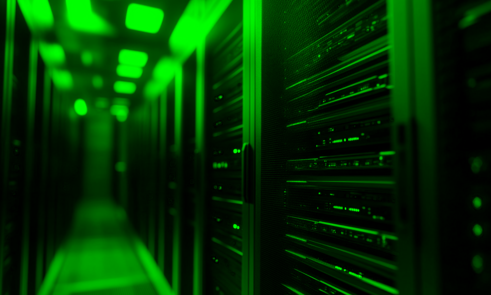

# TC1038 – Solución de la práctica: matrices y procesamiento de imágenes

**Asignatura:** Fundamentos de programación  
**Entorno:** Python con Thonny  
**Imagen de trabajo:** `big-data.jpg` (proporcionada para la práctica)  
**Enfoque:** programación estructurada, funciones y matrices; sin clases definidas por el alumno.

## 1. Objetivo

Implementar funciones para cargar y analizar una imagen, mostrar sus píxeles como matrices, convertirla a escala de grises y blanco y negro, y separar sus componentes rojo, verde y azul (RGB).

## 2. Configuración de Thonny

1. Instalar Thonny y abrir **Herramientas → Administrar paquetes**.
2. Instalar `Pillow`, `numpy` y `matplotlib` en el intérprete seleccionado.
3. Guardar `big-data.jpg` y el archivo `.py` en la misma carpeta.
4. Abrir el programa en Thonny y ejecutarlo con **F5**.
5. Observar las matrices en la consola y las imágenes en el panel de gráficos o en ventanas externas, según la configuración.

Alternativamente, en una terminal asociada al mismo intérprete:

```bash
python -m pip install pillow numpy matplotlib
```

**Nota:** Thonny permite ver imágenes mediante Matplotlib. `Pillow` también puede abrir el visor predeterminado del sistema con `Image.show()`, aunque aquí se utiliza `plt.imshow()`.

## 3. Fundamentos: cómo se representa una imagen

- **Píxel:** unidad mínima de información visual.
- **RGB:** cada píxel contiene tres intensidades: rojo (R), verde (G) y azul (B), entre 0 y 255.
- **Matriz RGB:** tiene tres dimensiones `(alto, ancho, 3)`.
- **Matriz de grises:** tiene dos dimensiones `(alto, ancho)` y valores de 0 (negro) a 255 (blanco).
- **Matriz binaria:** contiene únicamente 0 o 255, después de aplicar un umbral.

Ejemplos de píxeles: rojo `(255, 0, 0)`, verde `(0, 255, 0)`, azul `(0, 0, 255)`, blanco `(255, 255, 255)` y negro `(0, 0, 0)`.

### Acceso a matrices

`matriz[fila, columna, canal]` permite consultar un valor. Los canales 0, 1 y 2 corresponden a R, G y B, respectivamente. `matriz[:, :, 0]` obtiene la matriz bidimensional del rojo.

## 4. Análisis EPS (Entrada – Proceso – Salida)

| Etapa | Descripción |
|---|---|
| **Entrada** | Ruta del archivo `big-data.jpg` y umbral entero de 0 a 255 (se utiliza 128). |
| **Proceso** | Abrir imagen, convertir a RGB, generar matriz NumPy, leer dimensiones, aplicar fórmula de grises, comparar con umbral y separar canales RGB. |
| **Salida** | Información numérica, matriz RGB, matrices gris/binaria/R/G/B y visualizaciones de la imagen original y procesadas. |

## 5. Fórmulas y condicionales

### Escala de grises

Se utiliza una aproximación ponderada:

$$G = 0.299R + 0.587V + 0.114A$$

Aquí **V** representa verde y **A** azul. El resultado se redondea al entero más cercano y se almacena como `uint8`. Por ejemplo, para el píxel `(10, 42, 80)`, la intensidad calculada es `36.764`, que se redondea a **37**.

### Blanco y negro

Con umbral $T=128$:

$$B(i,j)=\begin{cases}255 & \text{si }G(i,j)\ge 128\\0 & \text{si }G(i,j)<128\end{cases}$$

En Python puede expresarse mediante `if/else` en ciclos anidados o mediante `np.where(grises >= 128, 255, 0)` para operar sobre toda la matriz.

## 6. Funciones implementadas

| Función | Parámetros | Devuelve o realiza |
|---|---|---|
| `cargar_imagen(ruta)` | Ruta de archivo | Matriz RGB NumPy |
| `mostrar_informacion(matriz)` | Matriz RGB | Imprime dimensiones, tipo y muestras |
| `mostrar_imagen(matriz, titulo)` | Matriz y título | Muestra imagen con Matplotlib |
| `convertir_grises(matriz)` | Matriz RGB | Matriz bidimensional gris |
| `convertir_blanco_negro(grises, umbral)` | Matriz gris y umbral | Matriz de 0 y 255 |
| `separar_rgb(matriz)` | Matriz RGB | Tres matrices: R, G y B |
| `crear_imagen_canal(canal, posicion)` | Canal y posición RGB | Imagen RGB con los otros canales en cero |
| `main()` | Ninguno | Ejecuta el flujo completo |

## 7. Código Python completo y resuelto

Guardar como `TC1038_solucion_imagenes.py`:

```python
from PIL import Image
import numpy as np
import matplotlib.pyplot as plt


def cargar_imagen(ruta):
    """Carga una imagen RGB y devuelve su matriz de píxeles."""
    imagen = Image.open(ruta).convert("RGB")
    matriz = np.array(imagen)
    return matriz


def mostrar_informacion(matriz):
    """Imprime dimensiones, tipo de datos y ejemplos de píxeles."""
    alto, ancho, canales = matriz.shape
    print("Dimensiones (alto, ancho, canales):", matriz.shape)
    print("Tipo de dato:", matriz.dtype)
    print("Total de valores:", matriz.size)
    print("Alto:", alto, "Ancho:", ancho, "Canales:", canales)
    print("Píxel [0, 0]:", matriz[0, 0])
    print("Píxel central:", matriz[alto // 2, ancho // 2])
    print("Fragmento 3 x 3 de la matriz RGB:")
    print(matriz[:3, :3, :])


def mostrar_imagen(matriz, titulo="Imagen"):
    """Muestra una matriz como imagen RGB o de un canal."""
    plt.figure(figsize=(10, 6))
    if matriz.ndim == 2:
        plt.imshow(matriz, cmap="gray", vmin=0, vmax=255)
    else:
        plt.imshow(matriz)
    plt.title(titulo)
    plt.axis("off")
    plt.tight_layout()
    plt.show()


def convertir_grises(matriz):
    """Calcula la intensidad de gris para cada píxel RGB."""
    rojo = matriz[:, :, 0].astype(float)
    verde = matriz[:, :, 1].astype(float)
    azul = matriz[:, :, 2].astype(float)
    grises = 0.299 * rojo + 0.587 * verde + 0.114 * azul
    return np.rint(grises).astype(np.uint8)


def convertir_blanco_negro(grises, umbral=128):
    """Convierte cada gris en 0 (negro) o 255 (blanco)."""
    if umbral < 0 or umbral > 255:
        raise ValueError("El umbral debe estar entre 0 y 255")
    return np.where(grises >= umbral, 255, 0).astype(np.uint8)


def separar_rgb(matriz):
    """Devuelve las tres matrices bidimensionales de color."""
    rojo = matriz[:, :, 0]
    verde = matriz[:, :, 1]
    azul = matriz[:, :, 2]
    return rojo, verde, azul


def crear_imagen_canal(canal, posicion):
    """Coloca un canal en una imagen RGB y los otros dos en cero."""
    alto, ancho = canal.shape
    resultado = np.zeros((alto, ancho, 3), dtype=np.uint8)
    resultado[:, :, posicion] = canal
    return resultado


def main():
    ruta = "big-data.jpg"
    matriz = cargar_imagen(ruta)
    mostrar_informacion(matriz)
    mostrar_imagen(matriz, "Imagen original")

    grises = convertir_grises(matriz)
    print("Matriz gris, primeras 3 filas y columnas:")
    print(grises[:3, :3])
    mostrar_imagen(grises, "Escala de grises")

    binaria = convertir_blanco_negro(grises, 128)
    print("Matriz binaria, primeras 3 filas y columnas:")
    print(binaria[:3, :3])
    mostrar_imagen(binaria, "Blanco y negro, umbral 128")

    rojo, verde, azul = separar_rgb(matriz)
    print("Canal rojo, muestra 3 x 3:\n", rojo[:3, :3])
    print("Canal verde, muestra 3 x 3:\n", verde[:3, :3])
    print("Canal azul, muestra 3 x 3:\n", azul[:3, :3])

    mostrar_imagen(crear_imagen_canal(rojo, 0), "Canal rojo")
    mostrar_imagen(crear_imagen_canal(verde, 1), "Canal verde")
    mostrar_imagen(crear_imagen_canal(azul, 2), "Canal azul")

    Image.fromarray(grises).save("escala_grises.png")
    Image.fromarray(binaria).save("blanco_negro.png")
    Image.fromarray(crear_imagen_canal(rojo, 0)).save("canal_rojo.png")
    Image.fromarray(crear_imagen_canal(verde, 1)).save("canal_verde.png")
    Image.fromarray(crear_imagen_canal(azul, 2)).save("canal_azul.png")
    print("Imágenes procesadas guardadas correctamente.")


if __name__ == "__main__":
    main()
```

**Observación técnica:** para la conversión a grises se convierten los canales a `float` antes de multiplicar. Así se evita la pérdida de precisión durante el cálculo. El resultado se redondea y se convierte a `uint8`.

## 8. Resultados reales con la imagen proporcionada

La imagen muestra un pasillo de equipos de servidores con iluminación predominantemente azul y luces rojas.

| Medida | Resultado |
|---|---:|
| Ancho | 2048 píxeles |
| Alto | 1230 píxeles |
| Canales | 3 |
| Forma de matriz RGB | `(1230, 2048, 3)` |
| Tipo de datos | `uint8` |
| Píxeles | 2,519,040 |
| Valores numéricos RGB | 7,557,120 |
| Primer píxel RGB | `[10, 42, 80]` |
| Píxel central RGB | `[6, 15, 32]` |
| Primer píxel en gris | `37` |
| Píxeles negros con T=128 | 2,249,228 |
| Píxeles blancos con T=128 | 269,812 |

Los resultados corresponden a la imagen original adjunta, convertida explícitamente a RGB. La conversión a gris utiliza la fórmula indicada y redondeo al entero más cercano.

### Imagen original


### Escala de grises


### Blanco y negro con umbral 128



### Separación RGB

**Rojo**


**Verde**



**Azul**


Cada canal se presenta como una imagen RGB con los otros dos canales en cero. Para visualizar únicamente la intensidad del canal en tonos de gris se puede utilizar `plt.imshow(rojo, cmap="gray", vmin=0, vmax=255)`.

## 9. Explicación de los resultados

- **Original:** combina tres matrices de intensidad para construir cada píxel de color.
- **Grises:** combina ponderadamente R, G y B y reduce la representación a una matriz bidimensional.
- **Blanco y negro:** clasifica cada intensidad gris en dos valores según una condición.
- **Canales RGB:** permite identificar qué componentes aportan mayor intensidad en distintas regiones. La imagen contiene una fuerte presencia visual de tonos azules.

## 10. Actividades y preguntas resueltas

**1. ¿Por qué la imagen RGB tiene tres dimensiones?** Porque además de filas y columnas cada píxel contiene tres componentes de color.

**2. ¿Cuántos elementos numéricos tiene la matriz RGB?** `1230 × 2048 × 3 = 7,557,120`.

**3. ¿Cuántos elementos tiene la matriz gris?** `1230 × 2048 = 2,519,040`.

**4. ¿Qué ocurre si se aumenta el umbral a 200?** Más píxeles se clasifican como negros y menos como blancos, porque se exige una intensidad mayor para obtener 255.

**5. ¿Qué ocurre si se reduce el umbral a 80?** Más píxeles se clasifican como blancos.

**6. ¿Por qué se utilizan funciones?** Para separar responsabilidades, reutilizar código, facilitar pruebas y hacer más legible el programa.

**7. ¿Qué diferencia hay entre `matriz[0, 0]` y `matriz[0, 0, 0]`?** La primera expresión devuelve los tres componentes del primer píxel; la segunda devuelve únicamente su componente roja.

**8. ¿Cómo recorrer una matriz gris con ciclos?**

```python
for fila in range(grises.shape[0]):
    for columna in range(grises.shape[1]):
        intensidad = grises[fila, columna]
        # Procesar intensidad
```

## 11. Comprobaciones recomendadas

```python
assert matriz.shape == (1230, 2048, 3)
assert grises.shape == (1230, 2048)
assert binaria.shape == (1230, 2048)
assert set(np.unique(binaria)).issubset((0, 255))
assert np.array_equal(matriz[:, :, 0], rojo)
```

Estas comprobaciones corresponden específicamente al archivo `big-data.jpg` proporcionado.

## 12. Conclusión

El procesamiento de imágenes permite aplicar directamente los conceptos de matrices, índices, funciones, condicionales y operaciones matemáticas. El ejercicio muestra que una imagen RGB se representa mediante una matriz tridimensional, mientras que las imágenes en escala de grises y binarias se representan mediante matrices bidimensionales. El trabajo con funciones facilita dividir el problema en tareas pequeñas y comprobables.

**Dependencias:** Python, Pillow, NumPy y Matplotlib.  
**Archivos de entrega:** código `.py`, imagen de entrada, resultados y explicación de las funciones.
